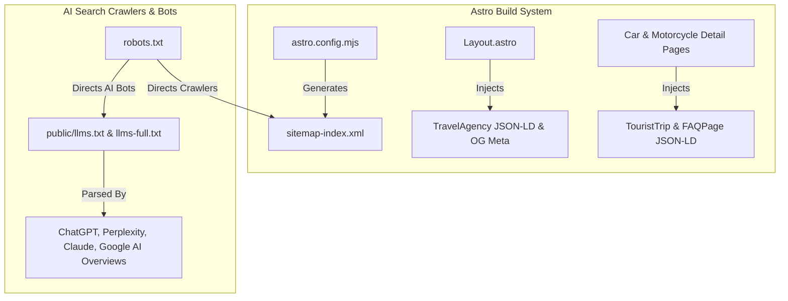

# Google SEO & LLM Search (GEO/LLMO) Optimization Implementation Plan

> **For agentic workers:** REQUIRED SUB-SKILL: Use superpowers:subagent-driven-development to implement this plan task-by-task. Steps use checkbox (`- [ ]`) syntax for tracking.

**Goal:** Implement full 360° SEO and Large Language Model Optimization (LLMO) across Plus530 Adventure to maximize search engine indexing, social card rendering, structured JSON-LD entity extraction, and machine-readable AI search visibility.

**Architecture:**
Integrate `@astrojs/sitemap` into Astro build pipeline, expand `Layout.astro` with OpenGraph/Twitter image fallbacks & `TravelAgency` JSON-LD schema, add direct-answer FAQ visual accordion components and `FAQPage` JSON-LD schema to trip detail pages, update `robots.txt` crawler policies, and maintain machine-readable `/llms.txt` and `/llms-full.txt`.

**Architecture Diagram:**



**Tech Stack:** Astro 4, TypeScript, `@astrojs/sitemap`, `@lucide/astro`, Schema.org JSON-LD.

## Global Constraints

- Domain floor: `https://plus530adventure.com`
- Static SSG Output (`output: 'static'` in `astro.config.mjs`).
- Preserve existing Astro file-based routes (`/car-tours/[slug]`, `/motorcycle-tours/[slug]`, `/timeline`).

---

### Task 1: Automated Sitemap & Robots.txt Alignment

**Files:**
- Modify: `astro.config.mjs`
- Modify: `package.json`
- Modify: `public/robots.txt`

- [ ] **Step 1: Install `@astrojs/sitemap` dependency**

Run: `pnpm add @astrojs/sitemap`
Expected: Successfully adds `@astrojs/sitemap` to dependencies in `package.json`.

- [ ] **Step 2: Update `astro.config.mjs` with sitemap integration**

```typescript
import { defineConfig } from 'astro/config';
import tailwind from '@astrojs/tailwind';
import sitemap from '@astrojs/sitemap';

export default defineConfig({
  site: 'https://plus530adventure.com',
  output: 'static',
  integrations: [tailwind(), sitemap()],
});
```

- [ ] **Step 3: Update `public/robots.txt` for AI crawlers**

```txt
User-agent: *
Allow: /

# Sitemaps
Sitemap: https://plus530adventure.com/sitemap-index.xml

# LLM Machine Readable Information
# Structured text map and summary for AI search engines & LLM web crawlers
# See https://llmstxt.org/ for details
LLMs-txt: https://plus530adventure.com/llms.txt
```

- [ ] **Step 4: Verify build generates sitemap**

Run: `pnpm build`
Expected: `dist/sitemap-index.xml` and `dist/sitemap-0.xml` are built successfully.

- [ ] **Step 5: Commit**

```bash
git add astro.config.mjs package.json pnpm-lock.yaml public/robots.txt
git commit -m "feat(seo): integrate @astrojs/sitemap and update robots.txt for AI bots"
```

---

### Task 2: OpenGraph Image Fallbacks & Organization Schema in Layout

**Files:**
- Modify: `src/layouts/Layout.astro`

- [ ] **Step 1: Add `image` prop and absolute image URL calculation**

Update `Layout.astro` frontmatter:
```astro
interface Props {
  title?: string;
  description?: string;
  image?: string;
}

const {
  title = "Plus530 Adventure | Himalayan Expeditions & Overland Trips",
  description = "Join Plus530 Adventure for luxury Himalayan overland expeditions, self-drive 4x4 trips, and high-altitude mountain journeys across Bhutan, Nepal, Ladakh, and Western Ghats.",
  image = "/images/adventures/bhutan-car-convoy.jpg"
} = Astro.props;

const siteUrl = "https://plus530adventure.com";
const fullImageUrl = image.startsWith('http') ? image : `${siteUrl}${image}`;
```

- [ ] **Step 2: Inject OpenGraph & Twitter image tags and expanded JSON-LD**

Update HTML `<head>` section in `Layout.astro`:
```astro
    <!-- Open Graph / Facebook -->
    <meta property="og:type" content="website" />
    <meta property="og:url" content={Astro.url.href} />
    <meta property="og:title" content={title} />
    <meta property="og:description" content={description} />
    <meta property="og:image" content={fullImageUrl} />
    <meta property="og:site_name" content="Plus530 Adventure" />

    <!-- Twitter -->
    <meta property="twitter:card" content="summary_large_image" />
    <meta property="twitter:url" content={Astro.url.href} />
    <meta property="twitter:title" content={title} />
    <meta property="twitter:description" content={description} />
    <meta property="twitter:image" content={fullImageUrl} />
```

- [ ] **Step 3: Verify clean build**

Run: `pnpm build`
Expected: Static build completes with zero errors.

- [ ] **Step 4: Commit**

```bash
git add src/layouts/Layout.astro
git commit -m "feat(seo): add OpenGraph image meta and expanded TravelAgency schema"
```

---

### Task 3: Interactive FAQ Accordion & FAQPage JSON-LD Component

**Files:**
- Create: `src/components/ui/FAQAccordion.astro`
- Modify: `src/pages/car-tours/[slug].astro`
- Modify: `src/pages/motorcycle-tours/[slug].astro`

- [ ] **Step 1: Create `src/components/ui/FAQAccordion.astro`**

```astro
---
import { HelpCircle, ChevronDown } from '@lucide/astro';

export interface FAQItem {
  question: string;
  answer: string;
}

interface Props {
  faqs: FAQItem[];
  title?: string;
}

const { faqs, title = "Frequently Asked Questions" } = Astro.props;

const faqSchema = {
  "@context": "https://schema.org",
  "@type": "FAQPage",
  "mainEntity": faqs.map((faq) => ({
    "@type": "Question",
    "name": faq.question,
    "acceptedAnswer": {
      "@type": "Answer",
      "text": faq.answer
    }
  }))
};
---

<script type="application/ld+json" is:inline set:html={JSON.stringify(faqSchema)} />

<div class="my-12">
  <div class="flex items-center gap-3 mb-6">
    <HelpCircle class="w-6 h-6 text-orange-600" />
    <h2 class="text-2xl font-bold text-gray-900">{title}</h2>
  </div>

  <div class="space-y-4">
    {faqs.map((faq, index) => (
      <details class="group bg-white rounded-xl border border-gray-200/80 p-5 shadow-sm transition-all duration-200 hover:border-orange-200">
        <summary class="flex justify-between items-center font-bold text-gray-900 cursor-pointer list-none text-base md:text-lg">
          <span>{faq.question}</span>
          <span class="transition group-open:rotate-180 text-orange-600 ml-4 flex-shrink-0">
            <ChevronDown class="w-5 h-5" />
          </span>
        </summary>
        <p class="text-gray-600 mt-3 text-sm md:text-base leading-relaxed border-t border-gray-100 pt-3">
          {faq.answer}
        </p>
      </details>
    ))}
  </div>
</div>
```

- [ ] **Step 2: Embed `FAQAccordion` on car tour detail pages (`src/pages/car-tours/[slug].astro`)**

Add standard expedition FAQs (vehicle suitability, convoy support, room occupancy, high altitude safety) to `[slug].astro`.

- [ ] **Step 3: Embed `FAQAccordion` on motorcycle tour detail pages (`src/pages/motorcycle-tours/[slug].astro`)**

Add motorcycle specific FAQs (bike model provided, chase vehicle support, riding gear requirements).

- [ ] **Step 4: Verify build**

Run: `pnpm build`
Expected: Static build completes with zero errors.

- [ ] **Step 5: Commit**

```bash
git add src/components/ui/FAQAccordion.astro src/pages/car-tours/\[slug\].astro src/pages/motorcycle-tours/\[slug\].astro
git commit -m "feat(seo): add FAQAccordion component with embedded FAQPage schema"
```

---

### Task 4: AI Machine-Readable Files Update (`public/llms.txt` & `public/llms-full.txt`)

**Files:**
- Modify: `public/llms.txt`
- Modify: `public/llms-full.txt`

- [ ] **Step 1: Update `public/llms.txt` URLs to point to `/car-tours/` and `/motorcycle-tours/`**

- [ ] **Step 2: Add timeline route `/timeline` and updated catalog list to `public/llms-full.txt`**

- [ ] **Step 3: Verify clean build**

Run: `pnpm build`
Expected: Clean build.

- [ ] **Step 4: Commit**

```bash
git add public/llms.txt public/llms-full.txt
git commit -m "docs(llm): align llms.txt and llms-full.txt with car-tours, motorcycle-tours, and timeline routes"
```

---

### Task 5: Build Verification & Production Deployment

- [ ] **Step 1: Run `pnpm build`**
- [ ] **Step 2: Run `pnpm exec wrangler pages deploy ./dist --project-name=plus530adventure`**
- [ ] **Step 3: Commit and verify live deployment link**
